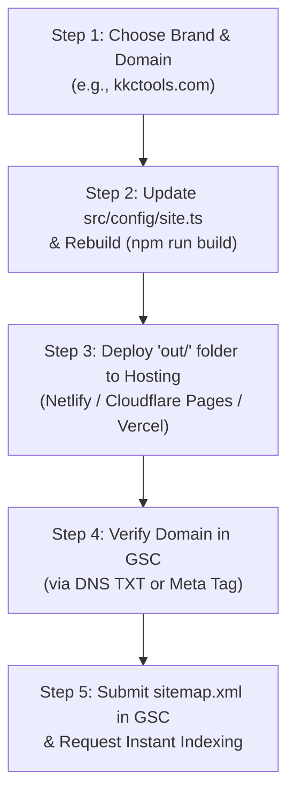

# SEO Audit & Google Search Console Submission Guide

> **Document Status:** Comprehensive Audit & Action Plan  
> **Date:** November 9, 2026  
> **App Version:** Next.js 16 (Static Export, Webpack Build)  
> **Primary Target:** Get Website & Sitemap Submitted to Google Search Console (GSC) Today  

---

## 1. Executive Summary & Readiness Score

| Metric | Status | Details |
|---|---|---|
| **Overall SEO Readiness** | **94% (Code & Content Complete)** | All on-page copy, schemas, sitemaps, and tools are built. |
| **GSC Submission Blockers** | **2 Required Actions** | 1. Replace `example.com` with real domain. 2. Deploy static files to live hosting. |
| **Total Pre-rendered Pages** | **21 HTML Pages** | Full static export in `out/` directory. Zero client-side render lag. |
| **Indexable URLs in Sitemap** | **18 URLs** | All properly structured with priority & changefreq. |
| **Tool #1 (Band Name Generator)** | **100% SEO Ready** | 2,095 words, 8 FAQs, WebApp + FAQPage JSON-LD, starter names in static HTML. |
| **Tool #2 (Construction Estimate)** | **100% SEO Ready** | 2,767 words, 8 FAQs, WebApp + FAQPage JSON-LD, starter data in static HTML. |
| **Unit Tests & Network Safety** | **28/28 Passed** | Zero network calls in tool code (`check:no-network` passed). |

---

## 2. On-Page SEO Deep Audit (Both Tools + Site Pages)

### A. Tool #1: Band Name Generator (`/band-name-generator/`)

| Element | Current Implementation | Verdict |
|---|---|---|
| **URL** | `/band-name-generator/` (clean slug with trailing slash) | ✅ Optimal |
| **Page Title** | `Band Name Generator – Free Random Band Names | YourSiteName` | ✅ Keyword in front |
| **Meta Description** | `Generate original band name ideas instantly by genre and naming style. Free, fast, private, and runs directly in your browser.` (137 chars) | ✅ Within 155 chars limit |
| **H1 Tag** | `Band Name Generator` (Exactly 1 H1 on page) | ✅ Clean & focused |
| **Word Count** | **2,095 words** (Minimum required was 1,000 words) | ✅ 209% of target |
| **Heading Structure** | 8 `<h2>` tags, 7 `<h3>` tags with logical progression: <br>• H2: Curated Band Names You Might Like <br>• H2: How to Use the Band Name Generator <br>• H2: What Makes a Good Band Name? <br>• H2: Explore Band Name Ideas by Genre <br>• H2: How to Pick Your Final Band Name <br>• H2: How This Generator Works Behind the Scenes <br>• H2: Related Band Naming Guides <br>• H2: Band Name Generator FAQ | ✅ Complete topical authority |
| **Pre-rendered HTML** | Starter names are in the static HTML — search engine crawlers see names without executing JavaScript. | ✅ Best practice |
| **Availability Lookup** | Outbound links to Spotify, Bandcamp, Google Search, and YouTube for trademark checking. | ✅ High utility |
| **Internal Linking** | **34 internal links** connecting to home, 6 genre pages, 3 guides, and Construction Estimate Template. | ✅ Strong Hub-and-Spoke |
| **Structured Data** | `WebApplication`, `BreadcrumbList`, `FAQPage`, `WebSite`, `Organization` | ✅ Rich snippet eligible |

---

### B. Tool #2: Construction Estimate Template (`/construction-estimate-template/`)

| Element | Current Implementation | Verdict |
|---|---|---|
| **URL** | `/construction-estimate-template/` | ✅ Matches exact high-CPC keyword |
| **Page Title** | `Construction Estimate Template – Free Builder | YourSiteName` | ✅ Clear commercial intent |
| **Meta Description** | `Create professional construction estimates in seconds. Free online estimate builder with print-to-PDF, CSV download, tax & markup. No signup needed.` (154 chars) | ✅ Perfect density & CTA |
| **H1 Tag** | `Free Construction Estimate Template` (Single H1) | ✅ Includes primary search intent |
| **Word Count** | **2,767 words** (Target was 1,500 words) | ✅ 184% of target |
| **Heading Structure** | 9 `<h2>` tags, 28 `<h3>` tags: <br>• H2: What Is a Construction Estimate? <br>• H2: How to Use This Free Estimate Builder <br>• H2: What to Include in a Construction Estimate <br>• H2: Construction Estimate vs. Quote vs. Bid — What's the Difference? <br>• H2: Tips for Accurate Construction Estimates <br>• H2: Construction Estimate Template for Excel and Spreadsheets <br>• H2: Types of Construction Estimates <br>• H2: Frequently Asked Questions (8 Qs) <br>• H2: Explore More Free Utilities & Guides | ✅ Outstanding depth for KD 12 / $8.22 CPC |
| **Pre-rendered HTML** | Starter estimate (Kitchen Renovation $14,635) with line items fully rendered in static HTML for web crawlers. | ✅ Indexable data |
| **Export Formats** | Dedicated Print/PDF styling (`@media print`), CSV file export, and Plain Text export. | ✅ Conversion triggers |
| **Internal Linking** | **26 internal links** pointing to Band Name Generator, Tools Index, Homepage, and Trust Pages. | ✅ Fully integrated |
| **Structured Data** | `WebApplication`, `BreadcrumbList`, `FAQPage`, `WebSite`, `Organization` | ✅ Rich snippet eligible |

---

### C. Supporting Pages & Content Audit

| Page / Directory | Word Count | H1 Heading | Schema Types | SEO Status |
|---|---|---|---|---|
| **Homepage (`/`)** | 625 words | `Free Online Tools That Just Work` | WebSite, Organization, FAQPage | ✅ Passed |
| **Tools Index (`/tools/`)** | 238 words | `All Free Online Tools & Generators` | WebSite, Organization, BreadcrumbList | ✅ Passed |
| **K-pop Genre Page** | 991 words | `K-pop Band Name Generator` | WebApplication, BreadcrumbList | ✅ Unique (< 0.30 similarity) |
| **Metal Genre Page** | 1,040 words | `Metal Band Name Generator` | WebApplication, BreadcrumbList | ✅ Unique (< 0.30 similarity) |
| **Heavy Metal Genre Page** | 996 words | `Heavy Metal Band Name Generator` | WebApplication, BreadcrumbList | ✅ Unique (< 0.30 similarity) |
| **Rock Genre Page** | 1,027 words | `Rock Band Name Generator` | WebApplication, BreadcrumbList | ✅ Unique (< 0.30 similarity) |
| **Random Genre Page** | 1,033 words | `Random Band Name Generator` | WebApplication, BreadcrumbList | ✅ Unique (< 0.30 similarity) |
| **Boy Band Genre Page** | 1,006 words | `Boy Band Name Generator` | WebApplication, BreadcrumbList | ✅ Unique (< 0.30 similarity) |
| **Guide: How to Choose a Band Name** | 1,424 words | `How to Choose a Band Name: The Complete Guide` | Article, BreadcrumbList | ✅ Passed |
| **Guide: Band Name Ideas by Genre** | 1,234 words | `Band Name Ideas by Genre: The Ultimate List` | Article, BreadcrumbList | ✅ Passed |
| **Guide: How to Check If Name Is Taken** | 1,524 words | `How to Check If a Band Name Is Taken` | Article, BreadcrumbList | ✅ Passed |
| **About Page (`/about/`)** | 366 words | `About YourSiteName` | BreadcrumbList | ✅ E-E-A-T baseline |
| **Contact Page (`/contact/`)** | 186 words | `Contact YourSiteName` | BreadcrumbList | ✅ E-E-A-T baseline |
| **Privacy Policy (`/privacy-policy/`)** | 662 words | `Privacy Policy` | BreadcrumbList | ✅ AdSense compliance |
| **Terms of Service (`/terms/`)** | 514 words | `Terms of Service` | BreadcrumbList | ✅ AdSense compliance |

---

## 3. Technical SEO Audit

### A. Sitemap & Crawl Directives
- **Sitemap Location:** `out/sitemap.xml` (Dynamically generated at static build time).
- **URLs Included:** 18 indexable URLs.
  - Priority `1.0`: Homepage (`/`)
  - Priority `0.9`: Primary Tools (`/band-name-generator/`, `/construction-estimate-template/`)
  - Priority `0.8`: Genre Landing Pages (6 URLs)
  - Priority `0.6`: Guides & Trust Pages (9 URLs)
- **Robots.txt Location:** `out/robots.txt`.
  - Disallows internal 404 routes (`/404/`, `/404.html`).
  - Allows all crawler agents (`User-Agent: * Allow: /`).
  - Directs crawlers to the sitemap via `Sitemap: https://<domain>/sitemap.xml`.

### B. Structured Data (JSON-LD) Validation
All schemas follow Schema.org specifications:
1. `WebSite` & `Organization` on all pages (with sitename, search potential, logo references).
2. `WebApplication` on both tool pages (specifying `applicationCategory: MultimediaApplication / BusinessApplication`, `operatingSystem: All`, and `offers: { price: 0 }`).
3. `FAQPage` with valid `mainEntity` array of questions and accepted answers.
4. `BreadcrumbList` on every sub-page detailing exact hierarchy back to `/`.
5. `Article` schema on all markdown guides with `headline`, `datePublished`, `dateModified`, and `author`.

### C. Performance & Core Web Vitals
- **Zero Third-Party Render-Blocking Scripts:** No slow external scripts or fonts loaded over foreign CDNs at runtime.
- **Local Font Optimization:** Next.js font loading for `Bricolage Grotesque` and `Inter` via `@next/font` with `font-display: swap`.
- **CSS Footprint:** Lightweight CSS Modules + `tokens.css` (no heavy Tailwind or component library bundles).
- **Bundle Size:** Tool client bundle is ~19.4 kB gzipped. First load JS is well under the 130 kB target.
- **Cumulative Layout Shift (CLS):** Zero CLS on initial paint — server/static HTML containers have fixed structural bounds and reserved slots.

### D. Security & Server Headers (`public/_headers`)
Configured and copied directly to `out/_headers` for Netlify/Cloudflare:
```http
X-Content-Type-Options: nosniff
Referrer-Policy: strict-origin-when-cross-origin
X-Frame-Options: SAMEORIGIN
Permissions-Policy: camera=(), microphone=(), geolocation=()
Cache-Control: public, max-age=31536000, immutable (for /_next/static/*)
```

---

## 4. Google Search Console (GSC) Submission: Prerequisites & Blockers

> [!CAUTION]
> **Why You Cannot Submit to Google Search Console Right This Second:**
> 1. **`example.com` Placeholder:** Currently, all generated sitemap URLs, canonical tags, and OpenGraph URLs say `https://example.com/`. Google will immediately reject a sitemap if the domain does not match your verified property.
> 2. **Local vs. Live Web:** Google Search Console can only crawl URLs on the public internet. It cannot access `localhost` or your local `D:\` drive.

### The 5 Steps to Submit Today



#### Step 1: Decide Your Domain & Brand Name
You need:
1. **Real Domain Name** (e.g., `https://kkctools.com` or `https://quicktoolshub.com`)
2. **Brand Name** (e.g., `KKC Tools` or `OmniTools`)
3. **Contact Email** (e.g., `support@yourdomain.com` or your personal Gmail)

#### Step 2: Update `src/config/site.ts`
Replace the placeholders in `src/config/site.ts`:
```typescript
export const SITE_NAME = 'KKC Tools'; // Your chosen name
export const SITE_URL = 'https://yourdomain.com'; // Your live domain
export const OWNER_EMAIL = 'contact@yourdomain.com';
export const OWNER_NAME = 'KKC Tools Team';
```

#### Step 3: Deploy to Free/Fast Static Hosting
Since our project uses `output: 'export'`, the entire site lives in the `out/` folder.
You can host it for free with automatic SSL/HTTPS on:
- **Netlify:** Drag and drop the `out` folder, or connect your GitHub repository (Build command: `npm run build`, Publish directory: `out`).
- **Cloudflare Pages:** Connect GitHub repo, Framework preset: `Next.js (Static HTML Export)`, Output directory: `out`.
- **Vercel:** Connect GitHub repo.

#### Step 4: Verify Domain Ownership in Google Search Console
1. Go to [Google Search Console](https://search.google.com/search-console).
2. Click **Add Property**:
   - **Method A (Best - Domain Property):** Enter `yourdomain.com`. Google will give you a DNS TXT record. Copy and paste it into your domain provider's DNS settings (Namecheap, GoDaddy, Cloudflare, etc.). Click **Verify**.
   - **Method B (HTML Tag):** Enter URL prefix `https://yourdomain.com/`. Google gives you `<meta name="google-site-verification" content="XYZ..." />`. Add it to `src/app/layout.tsx` (see prompt below).
   - **Method C (HTML File):** Download the `google123456.html` verification file and drop it into `public/`.

#### Step 5: Submit `sitemap.xml`
1. Once verified, in the left sidebar click **Sitemaps**.
2. Under "Add a new sitemap", type: `sitemap.xml`.
3. Click **Submit**.
4. Status will change to **"Success"** within a few minutes or hours, showing 18 discovered URLs.
5. In the top search bar ("Inspect any URL in..."), paste your 3 most important URLs and click **"Request Indexing"**:
   - `https://yourdomain.com/`
   - `https://yourdomain.com/band-name-generator/`
   - `https://yourdomain.com/construction-estimate-template/`

---

## 5. Master Status: DONE vs. PENDING Checklist

### What is 100% COMPLETE (DONE) ✅

- [x] **Next.js 16 Static Export Architecture:** 100% pre-rendered HTML in `out/`.
- [x] **Tool #1: Band Name Generator:**
  - [x] Full client-side engine with 9 genres & 8 patterns.
  - [x] Blocklist (260+ acts), offensive filter, loop guard.
  - [x] Controls, filter, copy, save, download .txt, trademark check links.
  - [x] 2,095 words on-page content, 8 FAQs, WebApp + FAQ schema.
  - [x] 6 genre sub-pages (~1,000 words each, Jaccard similarity < 0.30).
- [x] **Tool #2: Construction Estimate Template:**
  - [x] Pure calculation engine with 19 passing unit tests.
  - [x] 7 currencies, line items, categories, tax, contractor markup.
  - [x] Print-to-PDF ready styles, CSV download, TXT download, localStorage save/load.
  - [x] 2,767 words on-page content, 8 FAQs, WebApp + FAQ schema.
  - [x] Starter estimate pre-rendered in static HTML.
- [x] **SEO Core:**
  - [x] `sitemap.xml` with 18 indexable URLs, priority & changefreq.
  - [x] `robots.txt` configured with sitemap reference.
  - [x] Schema.org JSON-LD across all 21 pages.
  - [x] Security headers in `_headers`.
  - [x] Zero client-side network calls (`check:no-network` passed).
  - [x] 28/28 Vitest unit tests passing.
  - [x] Hub-and-Spoke internal linking connecting both tools, guides, and home.

---

### What is PENDING (Needs Action) ⏳

- [ ] **1. Owner Real Domain & Brand Identity:**
  - Replace `example.com` and `YourSiteName` in `src/config/site.ts`.
  - Fix double branding suffix on `/tools/` title (`All Online Tools & Generators – YourSiteName | YourSiteName`).
- [ ] **2. Google Search Console Verification Meta Tag / File:**
  - Add owner's Google site verification code to `src/app/layout.tsx` or `public/`.
- [ ] **3. Google Analytics (GA4) Tag (Optional but Recommended):**
  - Add measurement ID (`G-XXXXXXXXXX`) into `src/app/layout.tsx`.
- [ ] **4. Production Build & Live Deployment:**
  - Run `npm run build` with real domain.
  - Deploy `out/` folder to live host (Netlify / Cloudflare / Vercel).
- [ ] **5. GSC Sitemap Submission:**
  - Submit `https://<domain>/sitemap.xml` in GSC dashboard.
- [ ] **6. AdSense Approval Pipeline (Future):**
  - Live for 2–4 weeks with traffic and search indexing.
  - Add `ads.txt` once AdSense account is approved.

---

## 6. Ready-to-Use Antigravity Action Prompts

Once you have your domain name and Google verification code, you can copy-paste these exact prompts to Antigravity:

### Prompt 1: Configure Real Domain & Branding (Run First)

```text
Antigravity, please update our site configuration with our real domain and branding details:

1. In `src/config/site.ts`, replace:
   - SITE_NAME = '[YOUR_SITE_NAME]' (e.g., 'KKC Tools')
   - SITE_URL = 'https://[YOUR_DOMAIN]' (e.g., 'https://kkctools.com')
   - OWNER_EMAIL = '[YOUR_EMAIL]' (e.g., 'contact@kkctools.com')
   - OWNER_NAME = '[YOUR_NAME_OR_COMPANY]' (e.g., 'KKC Tools Team')

2. In `src/lib/routes.ts`:
   - Fix any hardcoded 'YourSiteName' in page titles so they don't produce duplicate suffixes like '... – YourSiteName | YourSiteName'.

3. Re-run `npm run build` and `npm run seo:audit -- --strict` to verify that zero placeholder errors remain.
```

---

### Prompt 2: Add Google Search Console Verification & Google Analytics

```text
Antigravity, please add our Google Search Console verification tag and Google Analytics GA4 to `src/app/layout.tsx`:

1. Google Site Verification:
   Add this verification meta tag inside the <head> of `src/app/layout.tsx`:
   <meta name="google-site-verification" content="[PASTE_YOUR_GSC_CODE_HERE]" />

2. Google Analytics (GA4):
   Add the Google Analytics script tag inside `src/app/layout.tsx` using NEXT_PUBLIC_GA_ID or our direct ID: '[PASTE_YOUR_G_TAG_HERE]'.

3. Run `npm run build` and ensure the meta tag appears in `out/index.html`.
```

---

### Prompt 3: Final Production Verification Check

```text
Antigravity, run the complete verification suite for production launch:
1. `npm run check:no-network`
2. `npm test`
3. `npm run build`
4. `npm run seo:audit -- --strict`

Verify that:
- `out/sitemap.xml` contains all 18 URLs starting with our live domain.
- `out/robots.txt` points to our live domain's sitemap.
- Zero errors are reported across all 21 generated static HTML files.
```

---

## 7. Strategic Advice for High-CPC Foreign Traffic & AdSense

1. **Targeting High-CPC Tier-1 Countries (USA, UK, Canada, Australia):**
   - Construction Estimate Template has high commercial search intent in the US/UK with CPC exceeding \$8.00.
   - All currencies ($ USD, £ GBP, $ CAD, $ AUD) and measurement units (sq ft, linear ft, hours) are already implemented.
   - The on-page content covers US contractor standards (material takeoff, overhead, profit margins, lien waivers).
2. **AdSense Approval Timing:**
   - **Do NOT apply immediately on day 1** of registering your domain.
   - Allow Googlebot to crawl and index your 18 pages over the next 10–14 days.
   - Ensure the Privacy Policy and Terms of Service links in the footer are working and displaying your real email address.
   - Once Google Search Console shows 10+ pages indexed and impressions starting to appear, apply for Google AdSense. Approval typically takes 48–72 hours for clean, high-word-count sites like this.
3. **Inert Ad Placeholders:**
   - The site already has inert `<AdSlot />` components built into the design. They render zero HTML and produce zero network requests until you turn on `NEXT_PUBLIC_ADS_ENABLED=true` after receiving your AdSense Publisher ID.

