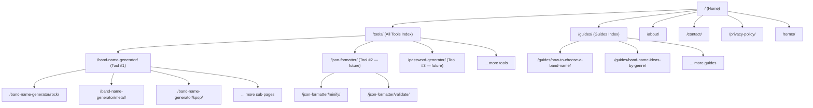
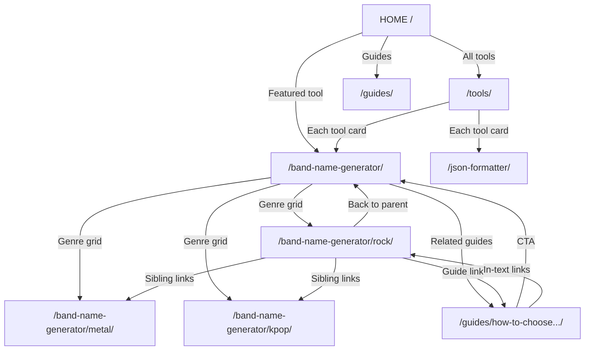

# SITE ARCHITECTURE & SEO BLUEPRINT
## Multi-Tool Website — Scalable Design for Ranking & Revenue

> **Purpose:** This is the master architecture document for a multi-tool website that will grow from 1 tool to 50+ tools over time. Every tool runs 100% client-side in the browser. Revenue comes from Google AdSense. Traffic comes from ranking low-KD English keywords targeting US, UK, Canada, and Australia.

> **How to use:** Give this file to any AI coding agent (Antigravity, Claude, etc.) along with specific tool specs to implement each phase.

---

## Table of Contents

1. [Vision & Strategy](#1-vision--strategy)
2. [Complete Site Map](#2-complete-site-map)
3. [URL Structure Rules](#3-url-structure-rules)
4. [Page Templates](#4-page-templates)
5. [Home Page Design](#5-home-page-design)
6. [Tool Page Design (Pillar)](#6-tool-page-design-pillar)
7. [Tool Sub-Page Design (Cluster)](#7-tool-sub-page-design-cluster)
8. [Tools Index Page](#8-tools-index-page)
9. [Guides & Blog](#9-guides--blog)
10. [Trust Pages](#10-trust-pages)
11. [SEO Strategy](#11-seo-strategy)
12. [Schema Markup (JSON-LD)](#12-schema-markup-json-ld)
13. [Internal Linking — Hub & Spoke](#13-internal-linking--hub--spoke)
14. [Google Search Console](#14-google-search-console)
15. [Google Analytics (GA4)](#15-google-analytics-ga4)
16. [Google AdSense](#16-google-adsense)
17. [Performance & Core Web Vitals](#17-performance--core-web-vitals)
18. [Design & UX Guidelines](#18-design--ux-guidelines)
19. [Adding a New Tool — SOP](#19-adding-a-new-tool--sop)
20. [Page Count Estimation](#20-page-count-estimation)
21. [Current Missing Items](#21-current-missing-items)
22. [Implementation Roadmap](#22-implementation-roadmap)

---

## 1. Vision & Strategy

### What we're building
A **fast, free, browser-based tool website** with dozens of useful utilities. Each tool targets a specific low-KD English keyword. The site earns money through Google AdSense display ads served to US/UK/CA/AU traffic.

### Why this works
- **Low-KD keywords** = less competition = faster rankings
- **Client-side tools** = no server cost, infinite scale, fast loading
- **Static export** = cheapest hosting (Netlify/Cloudflare free tier)
- **Each tool = 5-10 pages** = rapid content growth
- **Foreign traffic** = higher CPC (US/UK ads pay 5-10x more than Indian ads)

### Key principles
1. **Tool-first**: The interactive tool is always above the fold
2. **Content supports the tool**: 600-2000 words of genuine, helpful content below the tool
3. **One keyword, one page**: No two pages compete for the same keyword
4. **Honest**: No fake reviews, fake stats, or misleading claims
5. **Fast**: Static HTML, minimal JS, self-hosted fonts, no third-party scripts until AdSense
6. **Scalable**: Adding a new tool should take 2-4 hours of work, not days

---

## 2. Complete Site Map



### All Page Types

| Page Type | URL Pattern | Example | Est. Count |
|---|---|---|---|
| Home | `/` | — | 1 |
| Tools Index | `/tools/` | — | 1 |
| Tool Main Page (Pillar) | `/{tool-slug}/` | `/band-name-generator/` | 1 per tool |
| Tool Sub-Page (Cluster) | `/{tool-slug}/{variant}/` | `/band-name-generator/rock/` | 3-8 per tool |
| Guides Index | `/guides/` | — | 1 |
| Individual Guide | `/guides/{slug}/` | `/guides/how-to-choose-a-band-name/` | 1-3 per tool |
| About | `/about/` | — | 1 |
| Contact | `/contact/` | — | 1 |
| Privacy Policy | `/privacy-policy/` | — | 1 |
| Terms of Service | `/terms/` | — | 1 |
| 404 | `/404.html` | — | 1 (noindex) |

---

## 3. URL Structure Rules

### Rules (never break these)

1. **Tools live at the root level**: `/band-name-generator/` NOT `/tools/band-name-generator/`
   - Why: Shorter URLs rank better. The keyword is immediately in the URL.
   - The `/tools/` page is just a directory index, NOT a URL prefix.

2. **Sub-pages are under the tool**: `/band-name-generator/rock/`
   - Creates a clean parent-child relationship
   - Breadcrumbs naturally show: Home › Band Name Generator › Rock

3. **Always use trailing slashes**: `/band-name-generator/` not `/band-name-generator`
   - Prevents duplicate URL issues

4. **Use hyphens, not underscores**: `band-name-generator` not `band_name_generator`

5. **Lowercase only**: Never use uppercase in URLs

6. **Keep it short**: Max 3 levels deep (domain / tool / variant /)

7. **Keyword in URL**: The URL slug should match the primary keyword
   - Tool: `/json-formatter/` for "json formatter"
   - Sub-page: `/json-formatter/minify/` for "json minify" or "minify json"

---

## 4. Page Templates

Every page on the site follows one of these templates. This makes it easy to add new tools — you just fill in the template with new content.

### Template Registry

| Template | Used By | Min Words | Schema Types |
|---|---|---|---|
| `HomeTemplate` | `/` | 350 | WebSite, Organization |
| `ToolsIndexTemplate` | `/tools/` | 150 | BreadcrumbList |
| `ToolPageTemplate` | `/{tool}/` | 1,000 | WebApplication, BreadcrumbList, FAQPage |
| `ToolSubPageTemplate` | `/{tool}/{variant}/` | 600 | WebApplication, BreadcrumbList, FAQPage |
| `GuidesIndexTemplate` | `/guides/` | 120 | BreadcrumbList |
| `GuideTemplate` | `/guides/{slug}/` | 1,000 | Article, BreadcrumbList |
| `TrustPageTemplate` | About, Contact, Privacy, Terms | varies | BreadcrumbList |
| `404Template` | `/404.html` | — | none (noindex) |

---

## 5. Home Page Design

The home page is the **hub** that connects visitors to every tool and content section.

### Layout (top to bottom)

```
┌──────────────────────────────────────────────────────────┐
│  HEADER (logo + nav: Tools, Guides, About)               │
├──────────────────────────────────────────────────────────┤
│                                                          │
│  1. HERO SECTION                                         │
│  ┌─────────────────────────┬────────────────────────┐    │
│  │ H1: "Free Online Tools  │  [Live Mini Tool       │    │
│  │  That Just Work"        │   Preview Card]         │    │
│  │                         │                         │    │
│  │ Subtitle: Fast,         │  Shows 5 band names    │    │
│  │ private, no sign-up     │  with Generate button  │    │
│  │                         │                         │    │
│  │ [Try Band Name Gen →]   │                         │    │
│  │ [Browse All Tools]      │                         │    │
│  └─────────────────────────┴────────────────────────┘    │
│                                                          │
│  2. FEATURED TOOLS (card grid)                           │
│  ┌──────────────┐  ┌──────────────┐  ┌──────────────┐   │
│  │ 🎸 Band Name │  │ 🔧 JSON      │  │ 🔒 Password  │   │
│  │ Generator    │  │ Formatter    │  │ Generator    │   │
│  │              │  │              │  │              │   │
│  │ Description  │  │ Description  │  │ Description  │   │
│  │ [Open →]     │  │ [Open →]     │  │ [Open →]     │   │
│  │ Rock Metal K │  │ Minify Valid │  │              │   │
│  └──────────────┘  └──────────────┘  └──────────────┘   │
│  "More tools are on the way. Suggest a tool →"          │
│                                                          │
│  3. POPULAR CATEGORIES (chip/tag buttons)                │
│  [🎸 Rock Names] [⚡ Metal Names] [✨ K-pop Names]       │
│  [🎤 Boy Band] [🎲 Random] [🔧 JSON Tools]             │
│                                                          │
│  4. HOW IT WORKS (3 step cards)                          │
│  ┌────────────┐  ┌────────────┐  ┌────────────┐        │
│  │ 01          │  │ 02          │  │ 03          │        │
│  │ Choose      │  │ Generate    │  │ Save &      │        │
│  │ Options     │  │ Instantly   │  │ Check       │        │
│  └────────────┘  └────────────┘  └────────────┘        │
│                                                          │
│  5. WHY USE OUR TOOLS (4 points)                         │
│  🔒 Privacy  ⚡ Speed  🎨 Quality  🚫 No Sign-up       │
│                                                          │
│  6. FROM THE GUIDES (3 guide cards)                      │
│  ┌──────────────┐  ┌──────────────┐  ┌──────────────┐   │
│  │ How to Choose│  │ Ideas by     │  │ Check if     │   │
│  │ a Band Name  │  │ Genre        │  │ Name Taken   │   │
│  └──────────────┘  └──────────────┘  └──────────────┘   │
│                                                          │
│  7. FAQ (4-5 questions, <details> elements)              │
│                                                          │
├──────────────────────────────────────────────────────────┤
│  FOOTER (4 columns: Tools, Categories, Guides, Company) │
└──────────────────────────────────────────────────────────┘
```

### Home Page Content Requirements
- **H1**: Contains "free online tools" or similar primary keyword
- **Min 350 words** of real content
- **Links to**: Every published tool, every published guide, trust pages
- **No fake tools**: Only show tools that actually exist. "More tools on the way" is honest.
- **Live preview card**: Shows one tool in compact mode (proves the tool works)
- **Schema**: WebSite + Organization JSON-LD

### Home Page SEO
- Title: `{SiteName} – Free Online Tools & Generators`
- Description: 70-160 chars, includes "free online tools"
- H1: "Free Online Tools That Just Work" (or similar)
- Keyword appears in first 100 words

---

## 6. Tool Page Design (Pillar)

This is the **most important page type**. Each tool's main page targets the primary keyword (e.g., "band name generator", "json formatter").

### Layout (top to bottom)

```
┌──────────────────────────────────────────────────────────┐
│  HEADER                                                  │
│  Breadcrumbs: Home › Band Name Generator                 │
├──────────────────────────────────────────────────────────┤
│                                                          │
│  H1: Band Name Generator                                │
│  Subtitle: Generate unique band names by genre...        │
│                                                          │
│  ┌─────────────────────────────────────────────────────┐ │
│  │                                                     │ │
│  │            ★ THE INTERACTIVE TOOL ★                 │ │
│  │                                                     │ │
│  │  Controls (left)     │    Results (right)            │ │
│  │  Genre chips          │    1. Crimson Throne  ♡ ⧉ ⌕ │ │
│  │  Style select         │    2. Wretched Legion ♡ ⧉ ⌕ │ │
│  │  Count: 5/10/20       │    3. The Iron Plague ♡ ⧉ ⌕ │ │
│  │  Starts with          │    ...                      │ │
│  │  Must include         │                             │ │
│  │  [GENERATE]           │    Saved (3) ▸              │ │
│  │                       │                             │ │
│  └─────────────────────────────────────────────────────┘ │
│                                                          │
│  [AD SLOT — inert placeholder] (between tool & content)  │
│                                                          │
│  ── CONTENT SECTIONS (1,000+ words total) ──             │
│                                                          │
│  H2: Names You Might Like (12 static example names)     │
│                                                          │
│  H2: How to Use the Band Name Generator                 │
│  (3-5 numbered steps)                                    │
│                                                          │
│  H2: What Makes a Good Band Name                        │
│  (memorable, searchable, genre-fit, available)            │
│                                                          │
│  H2: Band Name Ideas by Genre                           │
│  ┌──────────┐  ┌──────────┐  ┌──────────┐              │
│  │ 🎸 Rock  │  │ ⚡ Metal │  │ ✨ K-pop │              │
│  │ 3 names  │  │ 3 names  │  │ 3 names  │              │
│  │ [Open →] │  │ [Open →] │  │ [Open →] │              │
│  └──────────┘  └──────────┘  └──────────┘              │
│                                                          │
│  [AD SLOT — in-content placeholder]                      │
│                                                          │
│  H2: How to Pick Your Final Name                        │
│  (shortlist, say aloud, search, check handles/domain)    │
│                                                          │
│  H2: How This Generator Works                           │
│  (word lists, patterns, browser-only, no AI)             │
│                                                          │
│  H2: FAQ (8 questions, <details> elements)              │
│  - Is it free?                                           │
│  - Are names unique?                                     │
│  - How to check if taken?                                │
│  - Can I use for my band?                                │
│  - Does it use AI?                                       │
│  - Can I save names?                                     │
│  - Genre-specific generation?                            │
│  - How many at once?                                     │
│                                                          │
│  H2: Related Guides                                     │
│  (2-3 guide links)                                       │
│                                                          │
│  [AD SLOT — before footer placeholder]                   │
│                                                          │
├──────────────────────────────────────────────────────────┤
│  FOOTER                                                  │
└──────────────────────────────────────────────────────────┘
```

### Tool Page SEO
- **Title**: `{Tool Name} – Free {Tool Description} | {SiteName}` (max 60 chars ideally, 65 hard limit)
- **H1**: Contains the primary keyword exactly (e.g., "Band Name Generator")
- **Meta description**: 70-160 chars, contains keyword naturally
- **Canonical**: Self-referencing, absolute URL
- **Schema**: WebApplication + BreadcrumbList + FAQPage
- **Primary keyword in**: Title, H1, first 100 words, one H2, meta description
- **Min 1,000 words** of content on the page
- **Links to**: All sub-pages (variants), 2-3 guides, home

---

## 7. Tool Sub-Page Design (Cluster)

Sub-pages target **long-tail variations** of the main keyword. They use the same tool component but pre-configured for a specific variant.

### Example sub-pages for Band Name Generator:

| URL | Target Keyword | Config |
|---|---|---|
| `/band-name-generator/rock/` | rock band name generator | genre=rock |
| `/band-name-generator/metal/` | metal band name generator | genre=metal |
| `/band-name-generator/kpop/` | kpop band name generator | genre=kpop |
| `/band-name-generator/random/` | random band name generator | genre=any |

### Sub-Page Layout

Same as Tool Page but:
- **Tool is pre-configured** to the variant (still changeable by user)
- **Unique content** — NOT a template with the genre word swapped
- **Min 600 words** of unique main content
- **FAQ**: 4-5 genre-specific questions (different from main page FAQ)
- **Example names**: 12 hand-written examples specific to the variant
- **Related links section**: Back to main tool + 3 sibling variants + 1-2 guides

### CRITICAL: Uniqueness Rule
The SEO audit checks **Jaccard similarity** between all sub-pages. If any two pages have similarity ≥ 0.30, the audit FAILS. This means:
- Each sub-page needs genuinely different advice, tips, and naming conventions
- Don't just swap "rock" for "metal" in the same template text
- Write unique H2 sections about what makes that genre's naming conventions unique

---

## 8. Tools Index Page

### Purpose
A directory of ALL published tools. This page grows as new tools are added.

### URL: `/tools/`

### Layout
```
Breadcrumbs: Home › Tools

H1: Free Online Tools & Generators

Intro paragraph (150+ words): What this site offers, why these tools
are useful, and that everything runs in the browser.

H2: Generators
┌──────────────┐  ┌──────────────┐  ┌──────────────┐
│ 🎸 Band Name │  │ 🔧 JSON      │  │ 🔒 Password  │
│ Generator    │  │ Formatter    │  │ Generator    │
│ Description  │  │ Description  │  │ Description  │
│ [Open →]     │  │ [Open →]     │  │ [Open →]     │
└──────────────┘  └──────────────┘  └──────────────┘

H2: Converters (future category)
...

H2: Calculators (future category)
...

"More tools are on the way. Suggest a tool → mailto:..."
```

### Key Rules
- **Only show tools that exist**. Never show "coming soon" cards with dead links.
- Group tools by category (Generators, Converters, Calculators, etc.)
- Each tool card shows: icon, name, one-line description, link to tool page
- Update this page every time a new tool is added

---

## 9. Guides & Blog

### Purpose
Guides provide **supporting content** that builds topical authority and captures informational keywords. Each tool should have 1-3 related guides.

### Guide Requirements
- **Min 1,000 words** of practical, original content
- Written in Markdown in `content/guides/` with frontmatter
- Rendered at build time using `gray-matter` + `marked`
- Each guide links to relevant tool pages (in-context, not just a list)
- Schema: Article with datePublished, dateModified

### Guides Index (`/guides/`)
- Lists all published guides
- Cards with title, description, date
- Min 120 words of intro content

### Guide Template Layout
```
Breadcrumbs: Home › Guides › Guide Title

H1: Guide Title
"Last updated: {date}"

[Auto-generated Table of Contents from H2s]

Content with H2 sections...

[Call-to-action card: "Try the Band Name Generator →"]

Related links to tools and other guides
```

### Future: Blog
When the site has 10+ tools, consider adding a `/blog/` section for:
- Tool comparison posts
- "Best X tools" roundups (only featuring YOUR tools honestly)
- Tutorial content for long-tail keywords
- Fresh content signals for Google

---

## 10. Trust Pages

**Required for AdSense approval.** These must exist before applying.

### About (`/about/`)
- What the site is and why it exists
- How the tools work (transparent: "curated word lists, runs in browser")
- Who runs it: `TODO(owner)` — a real person or brand name
- How to reach the owner
- Min 250 words
- No fake team bios, no fake credentials

### Contact (`/contact/`)
- `mailto:` link to owner email
- Expected response time: `TODO(owner)`
- No form needed (no backend)
- Min 100 words

### Privacy Policy (`/privacy-policy/`)
- Tools don't send data anywhere
- Favorites stored in localStorage only
- Hosting provider logs (standard)
- Sections for "If analytics enabled" and "If ads enabled" (clearly marked)
- **Not legal advice** — owner should have a lawyer review
- No word count minimum

### Terms of Service (`/terms/`)
- Free tool, provided "as is"
- Generated output not checked for trademarks
- External links disclaimer
- Changes to terms clause
- No word count minimum

### Rules for Trust Pages
- **No ads** on legal pages (Privacy, Terms)
- Light ads OK on About and Contact after AdSense approval
- These pages must have proper metadata, breadcrumbs, and canonical URLs

---

## 11. SEO Strategy

### 11.1 Keyword Research Workflow

Before building any new tool:

1. **Find low-KD keywords** using SEMrush, Ahrefs, or Ubersuggest
   - Target KD ≤ 15 (easy to rank)
   - Monthly search volume ≥ 500 (US)
   - Intent: "tool" or "generator" or "converter" (transactional/navigational)

2. **Check competition**: Search the keyword on Google
   - If page 1 has mostly big sites (GitHub, W3Schools) → harder
   - If page 1 has small tool sites → good opportunity
   - If page 1 has no dedicated tools → great opportunity

3. **Find sub-page keywords**: Long-tail variants
   - e.g., "band name generator" → "rock band name generator", "kpop band name generator"
   - Each sub-page should have its own keyword with volume

4. **Document in `docs/04-KEYWORDS.md`**: Record keyword, volume, KD, URL target

### 11.2 On-Page SEO Checklist (EVERY page)

- [ ] Exactly ONE `<h1>` containing the primary keyword
- [ ] Primary keyword in the first 100 words
- [ ] Primary keyword in at least one H2
- [ ] Primary keyword in the title tag
- [ ] Primary keyword in the meta description
- [ ] Title tag ≤ 65 characters (ideally ≤ 60)
- [ ] Meta description 70-160 characters
- [ ] Self-referencing canonical URL (absolute, with trailing slash)
- [ ] Open Graph tags (og:title, og:description, og:image, og:url)
- [ ] Twitter card meta (summary_large_image)
- [ ] Logical heading hierarchy (H1 → H2 → H3, no skipping)
- [ ] All images have meaningful `alt` text
- [ ] Descriptive internal link anchors (never "click here")
- [ ] Breadcrumbs on every inner page
- [ ] `lang="en"` on `<html>`
- [ ] Viewport meta tag
- [ ] No duplicate titles across the site
- [ ] No duplicate descriptions across the site

### 11.3 Technical SEO Files

| File | Location | Purpose |
|---|---|---|
| `sitemap.xml` | `/sitemap.xml` (generated) | Lists all indexable URLs for Google |
| `robots.txt` | `/robots.txt` (generated) | Allow all, reference sitemap |
| `favicon.ico` | `/favicon.ico` | Browser tab icon |
| `icon.svg` | `/icon.svg` | Modern browser icon |
| `apple-touch-icon.png` | `/apple-touch-icon.png` | iOS home screen |
| `opengraph-image` | Generated per page or default | Social sharing image 1200×630 |
| `_headers` | `public/_headers` | Security headers, caching |
| `ads.txt` | `/ads.txt` (Phase 7 only) | AdSense publisher verification |

### 11.4 Sitemap Rules
- Include ALL indexable pages
- Exclude: 404 page, any noindex pages
- Include `<lastmod>` dates from content files
- Regenerate on every build
- Submit to Google Search Console after deployment

### 11.5 Robots.txt
```
User-agent: *
Allow: /
Sitemap: https://yourdomain.com/sitemap.xml
```

---

## 12. Schema Markup (JSON-LD)

Every page gets appropriate structured data. This helps Google understand your content and can enable rich results.

| Page Type | Schema Types | Notes |
|---|---|---|
| Home | `WebSite`, `Organization` | name, url — no fake address/phone |
| Tool Page | `WebApplication`, `BreadcrumbList`, `FAQPage` | `isAccessibleForFree: true`, NO `aggregateRating`, NO fake reviews |
| Tool Sub-Page | `WebApplication`, `BreadcrumbList`, `FAQPage` | Same rules as tool page |
| Guide | `Article`, `BreadcrumbList` | datePublished, dateModified, author = Organization |
| Trust Pages | `BreadcrumbList` | minimal schema |
| Tools Index | `BreadcrumbList` | just breadcrumbs |

### Rules
- Every JSON-LD block must have `@context` and `@type`
- FAQPage schema must **exactly match** the visible FAQ text on the page
- Never add `aggregateRating` or fake reviews
- The SEO audit script validates all JSON-LD automatically

---

## 13. Internal Linking — Hub & Spoke

Internal linking is **critical** for SEO. It tells Google which pages are important and how they relate.



### Linking Rules

| From | Link To | How |
|---|---|---|
| Home | Every published tool | Featured tools card grid |
| Home | Every published guide | Guide cards section |
| Home | Trust pages | Footer |
| Tool Main | All its sub-pages | Genre/variant grid with descriptive anchors |
| Tool Main | 2-3 guides | "Related Guides" section |
| Tool Main | Home | Breadcrumbs |
| Sub-page | Parent tool | Breadcrumbs + "Back to {Tool Name}" anchor |
| Sub-page | 3 sibling sub-pages | "Related generators" section |
| Sub-page | 1-2 guides | In-content links |
| Guide | Relevant tool | CTA card + in-text links |
| Guide | Relevant sub-pages | In-text links (natural) |
| Footer | Tools, Categories, Guides, Company | On every page |

### Rules
- **No orphan pages**: Every page must have at least 2 inbound internal links
- **Descriptive anchors**: "Rock band name generator" not "click here"
- **No broken links**: The SEO audit checks for this
- **Breadcrumbs on every inner page**: With BreadcrumbList schema

---

## 14. Google Search Console

### Setup Steps (after deployment)

1. **Create property** at [search.google.com/search-console](https://search.google.com/search-console)
2. **Verify ownership** using one of:
   - DNS TXT record (recommended for domain-level property)
   - HTML file upload to `public/` folder
   - HTML meta tag in `<head>`
3. **Submit sitemap**: Enter `https://yourdomain.com/sitemap.xml`
4. **Request indexing**: Use URL Inspection tool for:
   - Home page
   - Main tool page
   - Each genre/sub-page
   - Guides
5. **Monitor**:
   - Index coverage (are all pages indexed?)
   - Core Web Vitals report
   - Search performance (clicks, impressions, position)
   - Any crawl errors

### What to add to the codebase

```
src/app/layout.tsx
  → Add Google Search Console verification meta tag:
     <meta name="google-site-verification" content="TODO(owner)" />
```

Or use DNS verification (no code change needed).

---

## 15. Google Analytics (GA4)

### Setup Steps

1. Create a GA4 property at [analytics.google.com](https://analytics.google.com)
2. Get your Measurement ID (format: `G-XXXXXXXXXX`)
3. Add the tracking script **conditionally** (only when enabled)

### Implementation

Create a component: `src/components/analytics/GoogleAnalytics.tsx`

```tsx
// Only renders when NEXT_PUBLIC_GA_ID is set
export default function GoogleAnalytics() {
  const gaId = process.env.NEXT_PUBLIC_GA_ID;
  if (!gaId) return null;

  return (
    <>
      <script async src={`https://www.googletagmanager.com/gtag/js?id=${gaId}`} />
      <script
        dangerouslySetInnerHTML={{
          __html: `
            window.dataLayer = window.dataLayer || [];
            function gtag(){dataLayer.push(arguments);}
            gtag('js', new Date());
            gtag('config', '${gaId}');
          `,
        }}
      />
    </>
  );
}
```

Add to `src/app/layout.tsx` inside `<head>`.

### Environment Variable
```
NEXT_PUBLIC_GA_ID=G-XXXXXXXXXX   # Set only when ready
```

### What to Track
- Page views (automatic with GA4)
- Tool usage events (custom events):
  - `generate_names` (with genre, count)
  - `copy_name`
  - `save_name`
  - `download_names`
- Consider adding these as `gtag('event', ...)` calls later (Phase 8)

---

## 16. Google AdSense

### 16.1 AdSense Approval Requirements

Before applying, the site MUST have:

- [x] **Original content**: No copied/scraped text
- [ ] **Enough pages**: At least 15-20 quality, indexable pages
- [ ] **Trust pages**: About, Contact, Privacy Policy, Terms
- [ ] **Clear navigation**: Users can easily find any page
- [ ] **No prohibited content**: No adult, violent, or deceptive content
- [ ] **Site age**: Domain should be at least 2-4 weeks old (some regions require more)
- [ ] **Real traffic**: Some organic or direct traffic helps (not required but helps)
- [ ] **Mobile friendly**: Responsive design
- [ ] **Fast loading**: Good Core Web Vitals

### 16.2 Ad Placement Strategy

```
Tool Page Ad Placements:
                                        
┌─────────────────────────────┐
│  Header                     │
│  H1 + Tool                  │  ← NO ads above the tool
│  [INTERACTIVE TOOL]         │
│                             │
│  ─── AD SLOT 1 ───          │  ← Between tool and content (leaderboard 728×90)
│                             │
│  H2: How to Use...          │
│  Content...                 │
│                             │
│  ─── AD SLOT 2 ───          │  ← In-content (rectangle 336×280)
│                             │
│  H2: More Content...        │
│  FAQ...                     │
│                             │
│  ─── AD SLOT 3 ───          │  ← Before footer (leaderboard 728×90)
│                             │
│  Footer                     │
└─────────────────────────────┘
```

### Placement Rules
- **Never place ads above the tool** — users should see the tool first
- **Max 3 ad units per page** (to start; can increase later)
- **Reserve space** in CSS to prevent layout shift (CLS)
- **No ads on**: Privacy Policy, Terms of Service, 404 page
- **Use responsive ad units** for mobile compatibility
- **The `AdSlot` component stays inert** until `NEXT_PUBLIC_ADS_ENABLED=true`

### 16.3 ads.txt

After AdSense approval, create `public/ads.txt`:
```
google.com, pub-XXXXXXXXXXXXXXXX, DIRECT, f08c47fec0942fa0
```
Replace with your actual publisher ID from AdSense dashboard.

### 16.4 CMP (Consent Management) for EU/UK

Google requires a Certified Consent Management Platform for EEA/UK traffic:
- Use Google's built-in consent message (free, in AdSense dashboard)
- Or use a certified CMP like Cookiebot
- Configure before enabling ads for EU/UK visitors

---

## 17. Performance & Core Web Vitals

Fast pages rank higher AND earn more from ads (Google reduces ad serving on slow pages).

### Targets (Mobile)

| Metric | Target | Limit |
|---|---|---|
| LCP (Largest Contentful Paint) | ≤ 2.0s | ≤ 2.5s |
| CLS (Cumulative Layout Shift) | ≤ 0.05 | ≤ 0.1 |
| INP (Interaction to Next Paint) | ≤ 150ms | ≤ 200ms |
| First Load JS (tool pages) | ≤ 100 kB | ≤ 130 kB |
| Lighthouse Performance | ≥ 90 | — |
| Lighthouse Accessibility | ≥ 95 | — |
| Lighthouse Best Practices | ≥ 95 | — |
| Lighthouse SEO | 100 | — |

### How to Achieve This

1. **Static export** (`output: 'export'`) — no server rendering overhead
2. **Self-hosted fonts** via `next/font` — no external font requests
3. **No third-party scripts** until Phase 7 (no analytics, no ads, no widgets)
4. **Minimal client JS** — tools use `'use client'` only where needed
5. **CSS Modules** — no runtime CSS-in-JS
6. **Reserve ad slot dimensions** in CSS — prevents CLS when ads load
7. **Lazy-load below-fold content** if needed
8. **Optimize images** — use SVG for icons, WebP for photos, proper sizing

### Testing
- Run `npm run build` and check "First Load JS" numbers
- Run Lighthouse on `npm run start` output
- Use [PageSpeed Insights](https://pagespeed.web.dev) on the live URL
- Record results in `docs/evidence/`

---

## 18. Design & UX Guidelines

### Design System

- **Fonts**: Bricolage Grotesque (headings) + Inter (body) via `next/font`
- **Colors**: CSS custom properties in `tokens.css` with light/dark themes
- **Spacing**: CSS custom properties (`--space-1` through `--space-8`)
- **Components**: Button, Chip, Card, Container, Section, Faq, Toast
- **No Tailwind**: Plain CSS with CSS Modules
- **No component libraries**: Custom components only

### UX Principles

1. **Tool above the fold**: On mobile (390×844), the tool's Generate button must be visible without scrolling
2. **Mobile-first**: Design for 390px first, then enhance for desktop
3. **Keyboard accessible**: Every interactive element works with Tab/Enter/Space
4. **Screen reader friendly**: `aria-live`, `aria-label`, proper landmarks
5. **Dark mode**: Respect `prefers-color-scheme`, allow manual toggle
6. **No layout shift**: Reserve space for results, toasts, and future ad slots
7. **Instant feedback**: Copy/Save actions show confirmation without shifting layout

### Responsive Breakpoints

| Breakpoint | Layout |
|---|---|
| < 640px | Single column, stacked |
| 640-899px | Some two-column layouts |
| ≥ 900px | Full two-column tool layout (controls left, results right) |
| ≥ 1120px | Max content width with centered container |

---

## 19. Adding a New Tool — SOP

When you have a new low-KD keyword and want to add a tool:

### Step 1: Keyword Research (Before coding)
- Confirm primary keyword, volume, and KD
- Identify 3-8 sub-page keywords (long-tail variants)
- Identify 1-2 guide topics
- Document in `docs/04-KEYWORDS.md`

### Step 2: Build the Tool Engine
```
src/lib/{tool-name}/
  ├── types.ts        # Input/output types
  ├── engine.ts       # Core logic (pure functions, no DOM, no network)
  └── engine.test.ts  # Tests
```
- All logic runs client-side
- No `fetch`, no APIs, no external calls
- Write tests that verify correctness

### Step 3: Build the Tool UI Component
```
src/components/tool/{tool-name}/
  ├── {ToolName}.tsx           # Main component
  ├── {ToolName}.module.css    # Styles
  ├── Controls.tsx             # Input controls
  ├── Results.tsx              # Output display
  └── ... (other sub-components)
```
- Must work on mobile (390px)
- Must be keyboard accessible
- Must have `aria-live` for dynamic results

### Step 4: Create Pages
```
src/app/{tool-slug}/
  ├── page.tsx                    # Main tool page (1,000+ words)
  └── [{variant}]/
      └── page.tsx                # Sub-pages (600+ words each)
          + generateStaticParams()
          + dynamicParams = false

src/content/tools/
  └── {tool-slug}.ts              # Tool config (title, description, variants, FAQ)
```

### Step 5: Create Supporting Guide(s)
```
content/guides/{guide-slug}.md    # 1,000+ words, frontmatter
```

### Step 6: Update Site-Wide Files
- [ ] Add tool to `src/lib/routes.ts`
- [ ] Add tool card to Home page
- [ ] Add tool card to `/tools/` index
- [ ] Add guide card to Home page
- [ ] Add guide to `/guides/` index
- [ ] Update Footer links if needed
- [ ] Update sitemap (automatic if routes.ts is updated)

### Step 7: Verify
```bash
npm run verify          # lint + test + build + no-network check + SEO audit
npm run seo:audit       # Check all pages pass
```

### Step 8: Deploy
```bash
git add -A
git commit -m "add: {tool-name} tool with {N} sub-pages and {N} guides"
git push                # Auto-deploys via Netlify/Cloudflare
```

---

## 20. Page Count Estimation

### With Tool #1 Only (Band Name Generator)

| Category | Pages | Details |
|---|---|---|
| Home | 1 | |
| Tools Index | 1 | |
| Tool Main | 1 | /band-name-generator/ |
| Tool Sub-pages | 6-8 | rock, metal, heavy-metal, kpop, boy-band, random (+punk, pop if confirmed) |
| Guides | 3 | How to choose, Ideas by genre, Check if taken |
| Guides Index | 1 | |
| Trust Pages | 4 | About, Contact, Privacy, Terms |
| 404 | 1 (noindex) | |
| **Total** | **18-20** | |

### Growth Projections

| Milestone | Est. Tools | Est. Pages | AdSense Ready? |
|---|---|---|---|
| Launch | 1 | 20 | ✅ Minimum met |
| Month 1-2 | 3 | 35-40 | ✅ Strong |
| Month 3-4 | 5 | 55-65 | ✅ Very strong |
| Month 6 | 8 | 85-100 | ✅ Excellent |
| Year 1 | 15+ | 150+ | ✅ Authority site |

### Example Future Tools (Low KD Keywords)

| Tool | Primary Keyword | Est. KD | Sub-pages |
|---|---|---|---|
| JSON Formatter | json formatter | ~15 | minify, beautify, validate, compare |
| Password Generator | password generator | ~10 | strong, memorable, pin |
| Lorem Ipsum Generator | lorem ipsum generator | ~5 | paragraphs, words, sentences |
| Case Converter | case converter | ~8 | uppercase, lowercase, title case, camel |
| Word Counter | word counter | ~12 | character counter, sentence counter |
| Color Palette Generator | color palette generator | ~10 | pastel, dark, neon, monochrome |
| QR Code Generator | qr code generator | ~15 | url, text, wifi, vcard |
| Base64 Encoder | base64 encoder decoder | ~8 | encode, decode, image |
| URL Encoder | url encoder decoder | ~5 | encode, decode |
| UUID Generator | uuid generator | ~8 | v4, v1, bulk |
| Markdown Preview | markdown preview | ~8 | github, table, cheatsheet |
| Emoji Picker | emoji picker | ~10 | by category, search |
| Unit Converter | unit converter | ~12 | length, weight, temperature |
| Age Calculator | age calculator | ~10 | birthday, days, months |
| Percentage Calculator | percentage calculator | ~8 | increase, decrease, of |

> **Note:** Always verify KD and volume with a real keyword tool before building. These are estimates.

---

## 21. Current Missing Items

### What exists today (Phase 0-3 complete)

- ✅ Project scaffolding (Next.js 16, TypeScript, App Router, static export)
- ✅ Design system (tokens.css, fonts, dark mode, UI primitives)
- ✅ Layout shell (Header, Footer, Breadcrumbs, 404)
- ✅ Band Name Generator engine (9 genres, pools, patterns, tests)
- ✅ Band Name Generator UI (controls, results, copy, save, check, download)
- ✅ Main tool page `/band-name-generator/` (2,200+ words, 8 FAQs, JSON-LD)
- ✅ Home page (basic — exists but needs review for Phase 4 requirements)
- ✅ SEO audit script
- ✅ No-network check script
- ✅ Verification pipeline

### What's missing (to be implemented)

#### Phase 4 — Pages (Completed ✅)
- [x] Home page review & update (verify 350+ words, all sections per spec — 598 words verified)
- [x] `/tools/` index page (150+ words — 192 words verified)
- [x] Genre config system (`src/content/genres/`)
- [x] Dynamic `[genre]` route with `generateStaticParams` (`src/app/band-name-generator/[genre]/page.tsx`)
- [x] `/band-name-generator/rock/` (1,027 words unique content)
- [x] `/band-name-generator/metal/` (1,040 words)
- [x] `/band-name-generator/heavy-metal/` (996 words, clearly different from metal)
- [x] `/band-name-generator/kpop/` (991 words)
- [x] `/band-name-generator/random/` (1,033 words)
- [x] `/band-name-generator/boy-band/` (1,006 words)
- [x] Hub-and-spoke internal links (genre pages ↔ main tool ↔ tools index ↔ home)
- [ ] `/band-name-generator/punk/` (BLOCKED — pending owner confirmation of volume/KD)
- [ ] `/band-name-generator/pop/` (BLOCKED — pending owner confirmation of volume/KD)

#### Phase 5 — Trust & Content (Completed ✅)
- [x] About page (366 words verified)
- [x] Contact page (186 words verified)
- [x] Privacy Policy (662 words verified, draft for owner review)
- [x] Terms of Service (514 words verified)
- [x] Markdown guide rendering pipeline (`content/guides`, `gray-matter`, `marked`, auto TOC, last-updated)
- [x] Guide: How to Choose a Band Name (1,424 words verified)
- [x] Guide: Band Name Ideas by Genre (1,234 words verified)
- [x] Guide: How to Check If a Band Name Is Taken (1,524 words verified)
- [x] Guides index page (203 words verified)

#### Phase 6 — SEO Infrastructure
- [ ] `sitemap.xml` generation (sitemap.ts)
- [ ] `robots.txt` generation (robots.ts)
- [ ] Proper favicon set (icon.svg, favicon.ico, apple-touch-icon.png)
- [ ] Default OG image (1200×630)
- [ ] JSON-LD on ALL page types
- [ ] Full SEO audit pass (zero errors)
- [ ] Genre page similarity check (< 0.30)
- [ ] No broken internal links
- [ ] First Load JS ≤ 130 kB on tool pages
- [ ] No console errors or third-party requests
- [ ] Complete docs bundle

#### Phase 7 — Launch & Monetization
- [ ] Owner provides: site name, domain, email, brand statement
- [ ] Replace all TODO(owner) placeholders
- [ ] Push to GitHub
- [ ] Deploy to Netlify/Cloudflare Pages
- [ ] Custom domain + HTTPS
- [ ] Google Search Console verification + sitemap submission
- [ ] Bing Webmaster Tools
- [ ] Request indexing for key pages
- [ ] Google Analytics (GA4) setup
- [ ] PageSpeed Insights audit
- [ ] Wait 2-4 weeks for indexing
- [ ] Apply for Google AdSense
- [ ] After approval: ads.txt, consent management, enable AdSlots
- [ ] Verify no layout shift from ads

#### Phase 8 — Growth
- [ ] Add Tool #2, #3, etc.
- [ ] Per-tool OG images
- [ ] Shareable results via URL hash
- [ ] Backlink outreach
- [ ] Community engagement
- [ ] Monitor Search Console for keyword opportunities

---

## 22. Implementation Roadmap

### Phase 4 → Implement next
**Goal:** All page types exist, site has 18-20 pages

**Tasks:** Build tools index, genre sub-pages, verify home page, hub-and-spoke linking

**Estimated effort:** 4-6 hours with AI agent

---

### Phase 5 → After Phase 4
**Goal:** Trust pages and guides ready for AdSense review

**Tasks:** About, Contact, Privacy, Terms, 3 guides, guides index

**Estimated effort:** 3-4 hours with AI agent

---

### Phase 6 → After Phase 5 (CHECKPOINT 2)
**Goal:** Full SEO infrastructure, audit passes with zero errors

**Tasks:** Sitemap, robots, favicons, OG images, full audit, performance check

**Estimated effort:** 2-3 hours with AI agent

---

### Phase 7 → After Phase 6
**Goal:** Live site, indexed by Google, ready for AdSense

**Tasks:** Deploy, configure domain, GSC, GA4, request indexing

**Estimated effort:** 1-2 hours (mostly owner actions)

**Owner must provide:**
- Site name
- Domain
- Contact email
- Brand statement for About page
- Volume/KD data for punk and pop sub-pages (optional)

---

### Phase 8 → Ongoing
**Goal:** Add more tools, grow traffic, earn revenue

**Cycle:** Research keyword → Build tool → Deploy → Index → Rank → Repeat

---

## Appendix A: File Structure (Scalable)

```
project-root/
├── public/
│   ├── _headers              # Security & caching headers
│   ├── favicon.ico
│   ├── icon.svg
│   ├── apple-touch-icon.png
│   └── ads.txt               # Only after AdSense approval
│
├── src/
│   ├── app/
│   │   ├── layout.tsx               # Root layout (header, footer, fonts, analytics)
│   │   ├── page.tsx                 # Home page
│   │   ├── not-found.tsx            # 404 page
│   │   ├── sitemap.ts               # Generated sitemap
│   │   ├── robots.ts                # Generated robots.txt
│   │   ├── opengraph-image.tsx      # Default OG image
│   │   │
│   │   ├── tools/
│   │   │   └── page.tsx             # Tools index
│   │   │
│   │   ├── band-name-generator/     # Tool #1
│   │   │   ├── page.tsx             # Main tool page
│   │   │   └── [genre]/
│   │   │       └── page.tsx         # Genre sub-pages
│   │   │
│   │   ├── json-formatter/          # Tool #2 (future)
│   │   │   ├── page.tsx
│   │   │   └── [variant]/
│   │   │       └── page.tsx
│   │   │
│   │   ├── guides/
│   │   │   ├── page.tsx             # Guides index
│   │   │   └── [slug]/
│   │   │       └── page.tsx         # Individual guide
│   │   │
│   │   ├── about/
│   │   │   └── page.tsx
│   │   ├── contact/
│   │   │   └── page.tsx
│   │   ├── privacy-policy/
│   │   │   └── page.tsx
│   │   └── terms/
│   │       └── page.tsx
│   │
│   ├── components/
│   │   ├── layout/                  # Header, Footer, Breadcrumbs, etc.
│   │   ├── ui/                      # Button, Card, Chip, Faq, Toast, etc.
│   │   ├── seo/                     # JsonLd, buildMetadata
│   │   ├── ads/                     # AdSlot (inert)
│   │   ├── analytics/               # GoogleAnalytics (conditional)
│   │   └── tool/
│   │       ├── band-name-generator/ # Tool #1 components
│   │       ├── json-formatter/      # Tool #2 components (future)
│   │       └── ... 
│   │
│   ├── lib/
│   │   ├── routes.ts                # All routes registry
│   │   ├── storage.ts               # Safe localStorage wrapper
│   │   └── generator/               # Tool #1 engine
│   │       ├── types.ts
│   │       ├── engine.ts
│   │       ├── engine.test.ts
│   │       ├── rng.ts
│   │       ├── patterns.ts
│   │       ├── blocklist.ts
│   │       ├── offensive.ts
│   │       └── pools/
│   │
│   ├── content/
│   │   ├── genres/                  # Band name generator genre configs
│   │   │   ├── rock.ts
│   │   │   ├── metal.ts
│   │   │   └── ...
│   │   └── tools/                   # Future tool configs
│   │
│   └── config/
│       └── site.ts                  # Site-wide config (name, URL, email)
│
├── content/
│   └── guides/                      # Markdown guide files
│       ├── how-to-choose-a-band-name.md
│       ├── band-name-ideas-by-genre.md
│       └── how-to-check-if-a-band-name-is-taken.md
│
├── scripts/
│   ├── verify.mjs                   # Full verification pipeline
│   ├── seo-audit.mjs                # SEO audit script
│   ├── check-no-network.mjs         # No-network-calls check
│   └── bundle-docs.mjs              # Documentation bundler
│
├── docs/
│   ├── 00-PROJECT-STATUS.md         # Master checklist
│   ├── 01-FEATURES.md
│   ├── 02-SEO.md
│   ├── 03-PAGES-AND-DESIGN.md
│   ├── 04-KEYWORDS.md
│   ├── 05-DEPLOY-AND-LAUNCH.md
│   ├── 06-MONETISATION.md
│   ├── SITE-ARCHITECTURE-BLUEPRINT.md  # THIS FILE
│   ├── _BUNDLE_FOR_REVIEW.md
│   ├── seo-audit-report.md
│   └── evidence/                    # Build outputs, test results
│
├── AGENTS.md                        # Standing rules for AI agents
├── package.json
├── next.config.ts
├── tsconfig.json
└── vitest.config.ts
```

---

## Appendix B: Quick Reference — What Goes Where

| Question | Answer |
|---|---|
| Where does a new tool's code go? | `src/components/tool/{name}/` + `src/lib/{name}/` |
| Where does a new tool's page go? | `src/app/{slug}/page.tsx` |
| Where do sub-pages go? | `src/app/{slug}/[variant]/page.tsx` with `generateStaticParams` |
| Where do guides go? | `content/guides/{slug}.md` |
| How to register a new route? | Add to `src/lib/routes.ts` |
| How to add to the home page? | Edit `src/app/page.tsx` — add a tool card |
| How to add to the footer? | Edit `src/components/layout/Footer.tsx` |
| How to enable ads? | Set `NEXT_PUBLIC_ADS_ENABLED=true` in `.env` |
| How to enable analytics? | Set `NEXT_PUBLIC_GA_ID=G-XXXXXXX` in `.env` |
| How to run all checks? | `npm run verify` |
| How to build for production? | `npm run build` (output in `out/`) |
| How to serve production build? | `npm run start` (serves `out/` on port 3000) |
| How to run dev server? | `npm run dev` |

---

> **Next step:** Give this document to your AI agent along with the MASTER_PROMPT and say:
> "Read `docs/SITE-ARCHITECTURE-BLUEPRINT.md` and `docs/00-PROJECT-STATUS.md`. Continue from Phase 4. Implement all tasks systematically."

